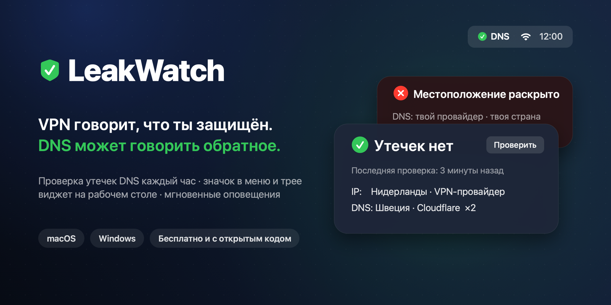
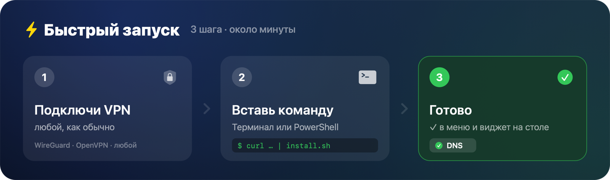

<p align="center"></p>

# LeakWatch

**VPN говорит, что ты защищён. DNS может говорить обратное.**

LeakWatch раз в час проверяет утечки DNS и показывает результат галочкой или крестиком в строке меню или трее и в небольшом виджете на рабочем столе. Если где-то всплывёт твоё реальное местоположение, ты сразу это увидишь и услышишь.

macOS · Windows · бесплатно · открытый код · без регистрации · без сбора данных

🇬🇧 [English version](README.en.md)

---

## ⚡ Быстрый запуск

<p align="center"></p>

Сначала подключи VPN, потом выполни **одну команду**. Установщик задаст 3 коротких вопроса, и всё готово.

###  macOS

Открой Терминал и вставь:

```bash
curl -fsSL https://github.com/Davidytka/leakwatch/archive/refs/heads/main.tar.gz | tar xz -C /tmp && /tmp/leakwatch-main/macos/install.sh
```

> Нужны Apple Command Line Tools. Если ты их никогда не ставил, сначала выполни `xcode-select --install`.

###  Windows

Нажми `Win + R`, введи `powershell`, нажми Enter и вставь:

```powershell
[Net.ServicePointManager]::SecurityProtocol='Tls12'; iwr https://github.com/Davidytka/leakwatch/archive/refs/heads/main.zip -UseBasicParsing -OutFile $env:TEMP\lw.zip; Expand-Archive $env:TEMP\lw.zip $env:TEMP\lw -Force; & "$env:TEMP\lw\leakwatch-main\windows\install.cmd"
```

> Удобнее мышкой? [Скачай ZIP](https://github.com/Davidytka/leakwatch/archive/refs/heads/main.zip), распакуй его и дважды кликни `windows\install.cmd`.

Вот и всё. В строке меню или трее появится ✓, а на рабочем столе — виджет. С этого момента проверка идёт каждый час.

---

## Проблема

Ты включаешь VPN и думаешь, что весь трафик идёт через туннель. Часто это не так.

- **Утечка DNS.** Прежде чем открыть сайт, браузер спрашивает, где находится example.com. Если этот вопрос уходит провайдеру, а не через VPN, провайдер (и все, кто за ним следит) видит каждый сайт, который ты открываешь, хотя сам трафик зашифрован.
- **VPN тихо отвалился.** После сна, смены Wi-Fi или обновления клиента VPN переподключился не так, как надо, и тебе никто ничего не сказал. Узнаёшь об этом через несколько часов или не узнаёшь вовсе.
- **Проверять вручную надоедает.** Сайты для проверки утечек работают, но только когда ты вспоминаешь их открыть. Каждый час этого никто не делает.

Для журналистов, удалёнщиков, тех, кто сидит в публичном Wi-Fi, и вообще для всех, кто пользуется VPN ради приватности, незамеченная утечка хуже, чем отсутствие VPN: ты ведёшь себя так, будто защищён.

## Что делает LeakWatch

- **Проверяет автоматически раз в час**, а также при входе в систему и после пробуждения из сна. Сначала дожидается, пока поднимутся сеть и VPN, поэтому ложных тревог нет.
- **Показывает статус с одного взгляда:** галочку или крестик в строке меню (macOS) или в трее (Windows) и виджет на рабочем столе.
- **Различает два уровня тревоги:**
  - 🟠 **Утечка.** IP или DNS-сервер оказался в стране не из твоего списка разрешённых. Приходит уведомление со звуком.
  - 🔴 **Раскрыто реальное местоположение.** Появилась твоя страна (или город либо провайдер из списка). Приходит уведомление, всплывает окно, которое висит, пока его не закроешь, и трижды звучит громкий сигнал.
- **Молчит, когда всё в порядке.**
- **Хранит историю:** последние проверки видны в меню, полный журнал лежит на диске.

| Значок | Что значит |
|---|---|
| ✓ зелёный | Утечек нет |
| ✗ оранжевый | Утечка в нежелательную страну или проверка не удалась (нет сети) |
| ✗ красный | Раскрыто реальное местоположение |
| 🔄 синий | Идёт проверка |
| 🕐 серый | Проверок не было больше 75 минут |

## Как это работает

LeakWatch использует открытый тест утечек [bash.ws](https://bash.ws/dnsleak). На том же принципе работают многие сайты для проверки утечек:

1. Программа получает у bash.ws уникальный случайный ID.
2. Запрашивает 10 уникальных адресов (`1.<id>.bash.ws` … `10.<id>.bash.ws`) **через обычный системный резолвер**, то есть тем же путём, что и браузер.
3. bash.ws сообщает, какие DNS-серверы на самом деле сделали эти запросы и из какой они страны и сети.
4. LeakWatch сравнивает это и твой публичный IP с твоими настройками.

Собственный вывод bash.ws «DNS may be leaking» программа **не использует**. Он срабатывает всякий раз, когда DNS-провайдер отличается от VPN-провайдера (например, если VPN использует DNS Cloudflare), и обычно это нормально. Решение принимают только твои списки разрешённых стран и слов-тревог.

**Приватность:** у LeakWatch нет своих серверов, и она ничего не собирает. Из внешних сервисов она обращается только к bash.ws, чтобы провести саму проверку. Результаты остаются на твоём компьютере.

## Установка

### macOS (13 Ventura или новее)

Нужны Apple Command Line Tools (`xcode-select --install`) и `jq`. В macOS 15+ `jq` уже встроен, в более старых версиях поставь его командой `brew install jq`.

```bash
git clone https://github.com/Davidytka/leakwatch.git
cd leakwatch/macos
./install.sh
```

Или нажми **Code → Download ZIP**, распакуй архив, открой Терминал в папке `macos` и выполни `./install.sh`.

Установщик:
1. попросит подключить VPN и проведёт первую проверку,
2. предложит страны, которые только что увидел, как **разрешённые** (нажми Enter, чтобы согласиться),
3. спросит **твою реальную страну**, при появлении которой включается красная тревога,
4. соберёт небольшое приложение (`~/Applications/LeakWatch.app`), запустит его и настроит автозапуск вместе с ежечасной проверкой при входе в систему.

Пароль администратора не нужен.

### Windows 10 / 11 (бета)

> ⚠️ Версия для Windows новая и ещё мало протестирована. Если что-то не работает, [создай issue](../../issues).

1. Нажми **Code → Download ZIP** и распакуй архив.
2. Открой папку `windows` и дважды кликни **`install.cmd`**.
3. Ответь на те же 3 вопроса, что и на macOS.

Используются только встроенные компоненты Windows (PowerShell + .NET). Ничего дополнительно ставить не нужно, права администратора тоже не нужны. Значок может оказаться среди скрытых значков (^). Перетащи его к часам, чтобы он всегда был виден.

## Настройки

| | macOS | Windows |
|---|---|---|
| Файл настроек | `~/.leakwatch/config.sh` | `%LOCALAPPDATA%\LeakWatch\config.json` |
| Журнал | `~/.leakwatch/leakwatch.log` | `%LOCALAPPDATA%\LeakWatch\leakwatch.log` |
| Открыть из программы | меню → **Edit settings** | трей → **Edit settings** |

- **Разрешённые страны** — где могут находиться серверы VPN и DNS. Названия пиши так, как их пишет bash.ws (например, `United States`, `Netherlands`). Оставь список пустым, чтобы отключить эту проверку.
- **Слова-тревоги** — всё, что означает «раскрыто моё реальное местоположение»: страна (`Russia` совпадёт и с `Russian Federation`), город или название провайдера. Слово из 2 букв, например `ir`, сравнивается с кодом страны.
- **Звуки:** на macOS — название встроенного звука (`Hero`, `Basso`, `Glass`…) или путь к аудиофайлу, на Windows — любой `.wav`-файл.

Изменения применяются со следующей проверки, перезапускать ничего не нужно.

## Удаление

- **macOS:** `~/.leakwatch/uninstall.sh`
- **Windows:** дважды кликни `windows\uninstall.cmd` или запусти `%LOCALAPPDATA%\LeakWatch\uninstall.ps1`

## Вопросы и ответы

**Пишет «Leak», хотя VPN включён.**
Возможно, твой VPN использует DNS-серверы в другой стране, чем сервер выхода. Если ты им доверяешь, добавь эту страну в список разрешённых.

**Программа исправляет утечки?**
Нет, она их только обнаруживает. Чтобы устранить утечку, включи в VPN-клиенте защиту от утечек DNS или kill switch либо вручную задай DNS-серверы VPN.

**Почему первая проверка после входа идёт долго?**
LeakWatch ждёт до 2 минут, пока поднимутся сеть и VPN. Так не бывает ложных тревог.

## Лицензия

[MIT](LICENSE): используй, меняй и распространяй свободно.
