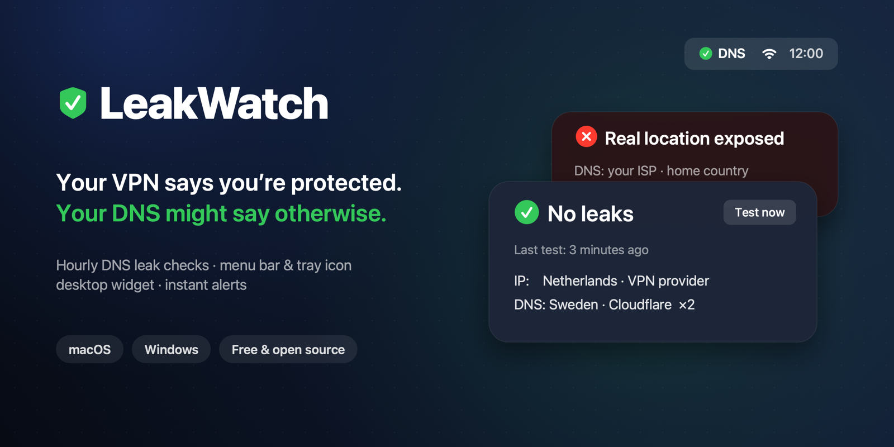

<p align="center"></p>

# LeakWatch

**Your VPN says you're protected. Your DNS might be saying otherwise.**

LeakWatch quietly checks for DNS leaks every hour and shows the result as a ✓ or ✗ in your menu bar / system tray and in a small desktop widget. If your real location ever shows up, you hear it and see it immediately.

macOS · Windows · free · open source · no account · no telemetry

🇷🇺 [Русская версия](README.ru.md)

---

## ⚡ Quick start

Connect your VPN first, then run **one command**. The installer asks 3 short questions and you're done.

**macOS:** open Terminal and paste:

```bash
curl -fsSL https://github.com/Davidytka/leakwatch/archive/refs/heads/main.tar.gz | tar xz -C /tmp && /tmp/leakwatch-main/macos/install.sh
```

> Needs Apple Command Line Tools. If you've never installed them, run `xcode-select --install` first.

**Windows:** press `Win + R`, type `powershell`, press Enter, and paste:

```powershell
[Net.ServicePointManager]::SecurityProtocol='Tls12'; iwr https://github.com/Davidytka/leakwatch/archive/refs/heads/main.zip -UseBasicParsing -OutFile $env:TEMP\lw.zip; Expand-Archive $env:TEMP\lw.zip $env:TEMP\lw -Force; & "$env:TEMP\lw\leakwatch-main\windows\install.cmd"
```

> Prefer clicking? [Download the ZIP](https://github.com/Davidytka/leakwatch/archive/refs/heads/main.zip), unzip it, and double-click `windows\install.cmd`.

That's it. A ✓ appears in your menu bar or tray and a widget appears on your desktop. Tests run every hour from now on.

---

## The problem

You turn on a VPN and assume everything goes through the tunnel. Often it doesn't.

- **DNS leaks.** Your browser asks "where is example.com?" before it connects anywhere. If that question goes to your ISP instead of through the VPN, your ISP (and anyone watching it) sees every site you visit, even though the traffic itself is encrypted.
- **Silent VPN drops.** The VPN reconnects after sleep, you switch Wi-Fi, or a client update resets a setting, and nothing tells you. You find out hours later, or never.
- **Checking by hand gets old.** Leak-test websites work, but only when you remember to open them. Nobody does that every hour.

For journalists, remote workers, people on public Wi-Fi, and anyone who uses a VPN for privacy, a leak you don't notice is worse than no VPN at all, because you behave as if you're protected.

## What LeakWatch does

- **Automatic test every hour**, plus at login and after waking from sleep. It waits for the network/VPN to come up first, so you don't get false alarms.
- **At-a-glance status:** a ✓ or ✗ icon in the menu bar (macOS) or tray (Windows), and a widget on your desktop.
- **Two alert levels:**
  - 🟠 **Leak.** Your IP or a DNS server is in a country outside your allowed list. You get a notification and a sound.
  - 🔴 **Real location exposed.** Your home country (or a city or ISP you list) shows up. You get a notification, a pop-up that stays until you close it, and a loud sound played 3 times.
- **Silent when everything is fine.**
- **History:** the last tests are in the menu, and a full log is kept on disk.

| Icon | Meaning |
|---|---|
| ✓ green | No leaks |
| ✗ orange | Leak to an unwanted country, or the test failed (offline) |
| ✗ red | Real location exposed |
| 🔄 blue | Test running |
| 🕐 gray | No test for more than 75 minutes |

## How it works

LeakWatch uses the open [bash.ws](https://bash.ws/dnsleak) DNS leak test, the same method as many leak-test websites:

1. It gets a unique random ID from bash.ws.
2. It looks up 10 unique names (`1.<id>.bash.ws` … `10.<id>.bash.ws`) **through your system's normal resolver**, the same path your browser uses.
3. bash.ws reports which DNS servers actually made those lookups, and from which country and network.
4. LeakWatch compares that, and your public IP, with your settings.

It does **not** rely on bash.ws's own "DNS may be leaking" verdict. That verdict fires whenever your DNS provider differs from your VPN provider (for example, a VPN using Cloudflare DNS), which is usually fine. Your own allowed and alert lists decide.

**Privacy:** LeakWatch has no servers and collects nothing. The only outside service it contacts is bash.ws, for the test itself. Results stay on your computer.

## Install

### macOS (13 Ventura or newer)

Requirements: Apple Command Line Tools (`xcode-select --install`) and `jq`, which is built into macOS 15+ (or `brew install jq`).

```bash
git clone https://github.com/Davidytka/leakwatch.git
cd leakwatch/macos
./install.sh
```

Or click **Code → Download ZIP**, unzip it, open Terminal in the `macos` folder, and run `./install.sh`.

The installer:
1. asks you to connect your VPN and runs a first test,
2. suggests the countries it just saw as your **allowed countries** (press Enter to accept),
3. asks for your **real country** (the red-alert trigger),
4. builds the small native app (`~/Applications/LeakWatch.app`) and starts it, plus the hourly test, at login.

No admin password needed.

### Windows 10 / 11 (beta)

> ⚠️ The Windows version is new and hasn't been widely tested yet. Please [open an issue](../../issues) if something doesn't work.

1. Click **Code → Download ZIP** and unzip it.
2. Open the `windows` folder and double-click **`install.cmd`**.
3. Answer the same 3 questions as on macOS.

It uses only built-in Windows components (PowerShell + .NET). Nothing extra to install, no admin rights. The tray icon may land in the hidden-icons area (^). Drag it next to the clock to keep it visible.

## Settings

| | macOS | Windows |
|---|---|---|
| Settings file | `~/.leakwatch/config.sh` | `%LOCALAPPDATA%\LeakWatch\config.json` |
| Log | `~/.leakwatch/leakwatch.log` | `%LOCALAPPDATA%\LeakWatch\leakwatch.log` |
| Open from the app | menu → **Edit settings** | tray → **Edit settings** |

- **Allowed countries:** where your VPN servers and DNS are allowed to be. Use the exact names bash.ws uses (e.g. `United States`, `Netherlands`). Leave it empty to skip this check.
- **Alert words:** anything that means "my real location is exposed": a country (`Russia` also matches `Russian Federation`), a city, or an ISP name. A 2-letter word such as `ir` is matched against the country code.
- **Sounds:** on macOS, any built-in sound name (`Hero`, `Basso`, `Glass`…) or a path to an audio file. On Windows, any `.wav` file.

Changes apply on the next test. No restart needed.

## Uninstall

- **macOS:** `~/.leakwatch/uninstall.sh`
- **Windows:** double-click `windows\uninstall.cmd`, or run `%LOCALAPPDATA%\LeakWatch\uninstall.ps1`

## FAQ

**It says "Leak" but my VPN is on.**
Your VPN may use DNS servers in a different country than its exit server. If you trust them, add that country to your allowed list.

**Does it fix leaks?**
No. It detects them. To fix a leak, turn on your VPN client's "DNS leak protection" / "kill switch", or set your VPN's DNS servers manually.

**Why does the first test after login take a while?**
LeakWatch waits up to 2 minutes for the network and VPN to come up, so you don't get false alarms.

## License

[MIT](LICENSE). Use it, change it, share it.
